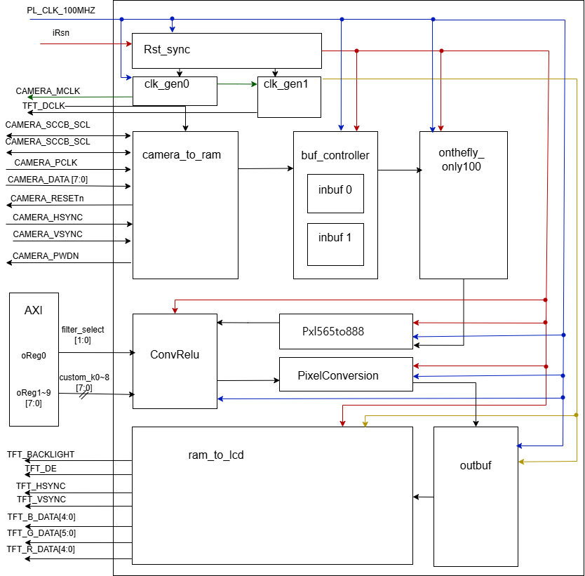
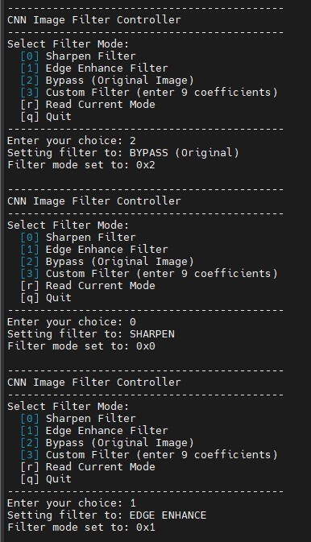
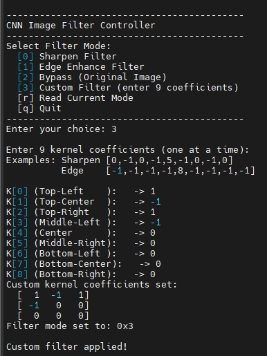
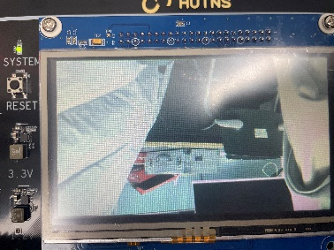
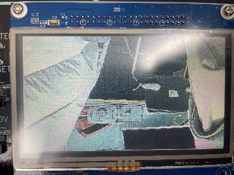
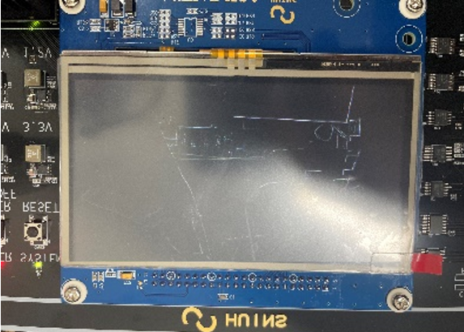

# Zynq PS-PL HW/SW Co-Design: 실시간 카메라-LCD Convolution 파이프라인

**Xilinx Zynq UltraScale+ MPSoC (Avnet Ultra96-V2 + HUINS EasySoC Pynq Rev 1.2)** 환경에서 **OV5640 카메라 입력 → RGB565 프레임 버퍼 → 3×3 슬라이딩 윈도우 → Convolution + ReLU 필터 → 4.3" TFT-LCD 실시간 출력**을 Verilog PL 파이프라인으로 구현하고, PS(Bare-metal C)에서 AXI-IIC·AXI-Lite를 통해 카메라 설정 및 커스텀 3×3 필터 계수를 실시간 제어하는 HW/SW Co-Design 프로젝트.

---

## 타겟 하드웨어 환경

- **SoC / FPGA:** Xilinx Zynq UltraScale+ MPSoC
- **모듈 / 베이스보드:** Avnet Ultra96-V2 + HUINS EasySoC Pynq (Rev 1.2)
- **입출력 장치:** OV5640 카메라 모듈, 4.3" TFT-LCD (TM043NBH02), UART 콘솔

---

## 주요 기능

- **PL 영상처리 파이프라인 (`Src/cam_top.v`)**
  - `camera_to_ram.v`: OV5640 `PCLK` 도메인 픽셀 수신, RGB565 워드 구성 및 입력 프레임 버퍼(BRAM) 기록
  - `buf_controller.v`: 카메라 `frame_done`과 연산·LCD 출력 타이밍 간 프레임 버퍼 중재
  - `onthefly_only100.v`: 입력 BRAM으로부터 3×3 슬라이딩 윈도우 실시간 생성
  - `Pxl565to888.v` / `PixelConversion.v`: RGB565 ↔ RGB888 포맷 변환
  - `ConvRelu.v`: 3×3 Convolution + ReLU 필터 연산 (`Bypass` / `Sharpen` / `Edge Enhance` / `Custom 9-coeff` 모드 지원)
  - `ram_to_lcd.v`: 출력 BRAM 독출 및 4.3" TFT-LCD(TM043NBH02) 동기 신호(`HSYNC`/`VSYNC`/`DE`/`DCLK`) 구동
- **PS ↔ PL AXI-Lite 연동 (`Src/S_AXI_LITE_REG_CNN.v`, `SW/source_code.c`)**
  - PS에서 AXI-IIC(`0xA001_0000`)로 OV5640 카메라 레지스터 초기화(`CamConfigData.h`)
  - UART 콘솔 메뉴를 통해 AXI-Lite(`0xA002_0000`)로 필터 모드 전환 및 3×3 커널 계수 9개 실시간 입력

---

## 아키텍처



*(모듈별 상세 블록 다이어그램은 [`Docs/Block_Diagram/`](Docs/Block_Diagram/) 참조: `camer_to_ram`, `buf_controller`, `onthefly100(InBuf)`, `Pxl565to888`, `ConvRelu`, `PixelConversion`, `ram_to_lcd`, `clk_gen2`)*

### PS-PL 메모리 맵 (`SW/source_code.c`)

| 주소 | 인터페이스 | 역할 |
| :--- | :--- | :--- |
| `0xA000_0000` | `AXI_GPIO` | 보드 제어용 GPIO |
| `0xA001_0000` | `AXI_IIC` | OV5640 카메라 I2C 초기화 (`0x78`/`0x79`) |
| `0xA002_0000` | `S_AXI_LITE_REG_CNN` | 필터 모드 선택 및 커스텀 3×3 커널 계수 제어 |

---

## 보드 실물 검증 결과 (`Docs/Demo/`)

Zynq FPGA 보드(HUINS 4.3" TFT-LCD + OV5640 카메라)에서 실시간 영상 입력과 UART AXI-Lite 필터 전환 동작 검증.

### 1. PS UART 필터 제어 인터페이스
| 필터 모드 선택 (`Bypass / Sharpen / Edge`) | 커스텀 3×3 커널 계수 실시간 입력 |
| :---: | :---: |
|  |  |

### 2. 4.3" TFT-LCD 실시간 출력 비교
| Bypass (원본 영상) | Sharpen 필터 | Edge Enhance 필터 |
| :---: | :---: | :---: |
|  |  |  |

---

## 디렉토리 구조

```text
2025-11_CNN_Project/
├── Src/
│   ├── cam_top.v               # Top-level 카메라-필터-LCD 통합 모듈
│   ├── camera_to_ram.v         # OV5640 PCLK 도메인 수신 및 BRAM 기록
│   ├── buf_controller.v        # 프레임 버퍼 읽기/쓰기 중재 제어
│   ├── onthefly_only100.v      # 3x3 슬라이딩 윈도우 생성기
│   ├── Pxl565to888.v           # RGB565 -> RGB888 변환
│   ├── ConvRelu.v              # 3x3 Convolution + ReLU 연산기
│   ├── PixelConversion.v       # RGB888 -> RGB565 변환
│   ├── ram_to_lcd.v            # TFT-LCD 타이밍 및 픽셀 출력
│   ├── S_AXI_LITE_REG_CNN.v    # PS-PL AXI-Lite 필터 제어 레지스터
│   ├── clk_gen2.v / Rst_sync.v # 클럭 생성 및 리셋 동기화
│   └── PL_Text-LCD.xdc         # 핀 제약 파일
├── SW/
│   ├── source_code.c / .h      # Zynq PS UART 메뉴, I2C 카메라 설정, AXI-Lite 제어
│   └── CamConfigData.h         # OV5640 I2C 초기화 테이블
├── Docs/
│   ├── Block_Diagram/          # 전체 및 모듈별 블록 다이어그램 (.drawio / .png)
│   └── Demo/                   # 보드 실물 UART/LCD 검증 캡처
└── README.md
```
